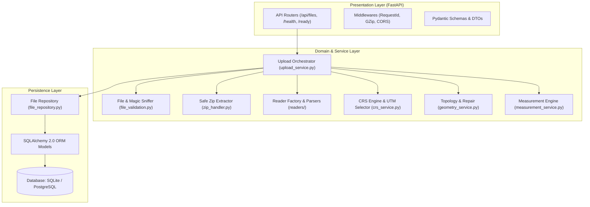
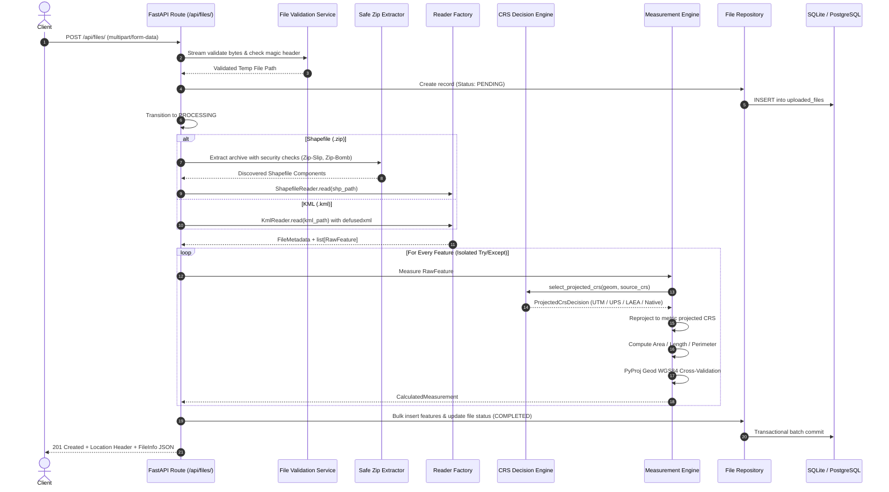
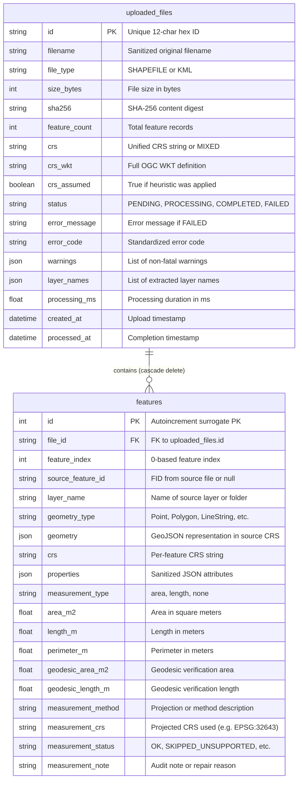

# Application Architecture & System Design

## 1. System Overview & Clean Layered Architecture

The **Geospatial File Measurement API** is engineered following strict Clean Architecture and Domain-Driven Design principles. High-level routing layers are decoupled from business services, which in turn are isolated from persistence and raw I/O boundaries.

---

## 2. End-to-End File Processing Flow

The processing pipeline is executed synchronously by default (yielding an immediate `201 Created` with full results) or asynchronously via `?async=true` (yielding `202 Accepted` and background execution).

---

## 3. Entity-Relationship Data Model

