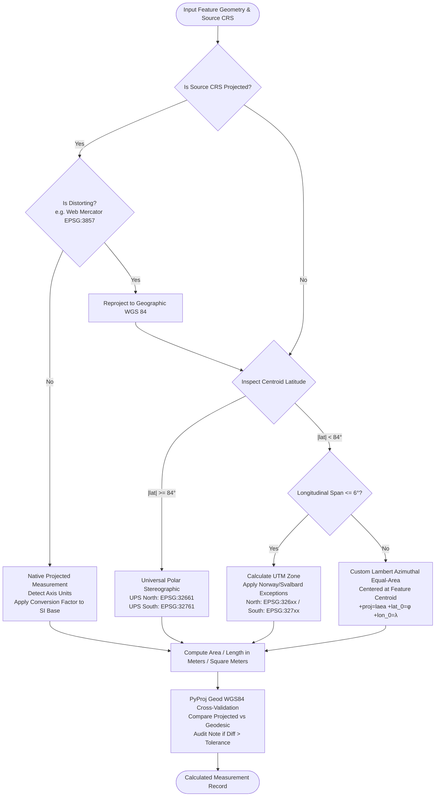

# Coordinate Reference System (CRS) Selection & Measurement Strategy

## 1. Executive Summary & Core Principle

In geospatial computing, **never compute area or distance directly on geographic coordinates (latitude and longitude in degrees)**. Geographic coordinates represent angular positions on a three-dimensional oblate ellipsoid (WGS 84 / GRS 80). 

Calculating planar Euclidean distance ($\sqrt{\Delta x^2 + \Delta y^2}$) or Shoelace polygon area directly on degree coordinates produces mathematically meaningless numbers whose physical scale varies wildly with latitude:
- At the Equator ($0^\circ$), $1^\circ$ of longitude spans approximately $111.32\text{ km}$.
- At $60^\circ\text{ N}$, $1^\circ$ of longitude spans only $55.80\text{ km}$ ($\cos(60^\circ) \approx 0.5$).
- A $1^\circ \times 1^\circ$ box at the equator measures $\approx 12,308.8\text{ km}^2$, whereas at $60^\circ\text{ N}$ it measures $\approx 6,154.4\text{ km}^2$.

The **Geospatial File Measurement API** enforces a strict projection pipeline: any geometry presented in a geographic CRS is dynamically reprojected to an optimal projected metric CRS prior to measurement, and cross-validated against an ellipsoidal geodesic calculation.

---

## 2. Projected CRS Selection Decision Tree

---

## 3. Detailed Decision Logic

### 3.1 Native Projected Coordinates & Unit Normalization
If the source file already supplies a projected CRS with metric or convertible linear units (such as UTM, State Plane, or British National Grid):
- **Safety check:** Verify that the projection is not conformal with severe area exaggeration (see Section 3.2).
- **Unit Normalization:** Inspect `crs.axis_info[0].unit_name` and `unit_conversion_factor`.
  - International Foot ($1\text{ ft} = 0.3048\text{ m}$)
  - US Survey Foot ($1\text{ survey ft} = \frac{1200}{3937}\text{ m} \approx 0.3048006096\text{ m}$)
  - Linear distances are scaled by `factor`, areas by `factor²`.
- **Measurement:** Computed natively without interpolation artifacts.

### 3.2 Web Mercator Distortion Rerouting
Web Mercator (`EPSG:3857`, `EPSG:900913`, `+proj=merc`) is designed for planar web map tile display, **not for metric measurements**. Its conformal scale factor increases with latitude as $\sec(\phi) = \frac{1}{\cos(\phi)}$:
- At $\phi = 60^\circ$, linear features are exaggerated by $2\times$, and area is exaggerated by $4\times$ ($400\%$).
- At $\phi = 80^\circ$, area is exaggerated by over $33\times$ ($3,316\%$).

**Remedy:** When `is_distorting_projection(crs)` detects Web Mercator or cylindrical Mercator projections, the service immediately reprojects the geometry to WGS 84 geographic coordinates and routes it through the standard UTM/LAEA selection pipeline.

### 3.3 UTM Zone Selection (Standard & Exceptions)
For geographic coordinates whose longitudinal extent fits within a standard 6-degree corridor:
- **Base formula:** $\text{Zone} = \lfloor\frac{\lambda + 180^\circ}{6^\circ}\rfloor + 1$
- **Hemisphere:** Northern hemisphere uses `EPSG:32601`–`EPSG:32660`; Southern hemisphere uses `EPSG:32701`–`EPSG:32760`.
- **Norway Exception:** Between $56^\circ\text{ N} \le \phi < 64^\circ\text{ N}$ and $3^\circ\text{ E} \le \lambda < 12^\circ\text{ E}$, UTM Zone 32 is expanded to cover southwestern Norway.
- **Svalbard Exceptions:** Between $72^\circ\text{ N} \le \phi < 84^\circ\text{ N}$, standard zones are modified to zones 31 ($0^\circ$–$9^\circ\text{E}$), 33 ($9^\circ$–$21^\circ\text{E}$), 35 ($21^\circ$–$33^\circ\text{E}$), and 37 ($33^\circ$–$42^\circ\text{E}$).

### 3.4 Polar Regions (UPS)
Standard UTM projections break down near the poles due to extreme meridian convergence. When centroid latitude $|\phi| \ge 84^\circ$:
- Northern Polar: Universal Polar Stereographic North (`EPSG:32661`).
- Southern Polar: Universal Polar Stereographic South (`EPSG:32761`).

### 3.5 Continental and Multi-Zone Spans (Custom LAEA)
When a geometry spans more than $6^\circ$ of longitude (spanning across multiple UTM zones, trans-continental corridors, or antimeridian crossings):
- A single UTM projection would suffer significant scale distortion near its outer edges.
- **Remedy:** The service synthesizes a **Lambert Azimuthal Equal-Area (LAEA)** projection centered precisely on the feature's centroid:
  `+proj=laea +lat_0={centroid_lat} +lon_0={centroid_lon} +datum=WGS84 +units=m +no_defs`
- LAEA is mathematically strictly equal-area across the entire globe, ensuring exact polygon surface preservation regardless of shape size.

---

## 4. Geodesic Verification Protocol

To provide total auditability, every measurement also calculates the geodesic ground-truth using `pyproj.Geod(ellps="WGS84")`:
- **Polygons:** `geod.geometry_area_perimeter(geom)` calculates geodesic surface area and perimeter using Karney's algorithms.
- **LineStrings:** `geod.geometry_length(geom)` calculates geodesic geodesic line distance.
- **Audit Tolerance Check:** The projected metric result is compared to the geodesic result:
  $$\Delta\% = \frac{|\text{Projected} - \text{Geodesic}|}{\text{Geodesic}} \times 100$$
- If $\Delta\%$ exceeds the configured threshold (`GEODESIC_TOLERANCE_PCT`, default 0.5%), a descriptive audit note is attached to the feature record. Both the primary projected measurement and the geodesic verification measurement are returned in the API response.

---

## 5. Performance Optimizations

1. **Transformer Caching:** Coordinate transformation objects (`pyproj.Transformer`) are cached via `@lru_cache(maxsize=128)` keyed on `(source_crs, target_crs)`.
2. **Axis Order Guarantee:** All transformers are initialized with `always_xy=True`, ensuring standard GIS `(x, y)` / `(lon, lat)` coordinate ordering regardless of PROJ authority defaults.
